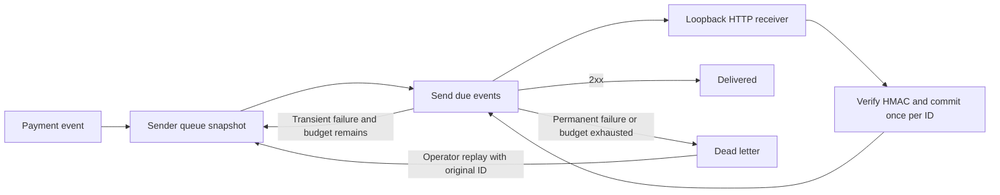

# Webhook Relay

A Java 17+ portfolio prototype for reliably delivering synthetic payment events to a local HTTP receiver. It answers a common backend interview question: **what if the receiver commits an event but the sender times out before getting the response?**

**No dependencies, credentials, real payment data, or external services needed.** The demo listens on an ephemeral IPv4 loopback port, sends only to that port, and does not follow redirects or use a proxy. This is an AI-assisted prototype, not a Stripe integration or a production system.

## Run locally

Install a **JDK**, not just a Java runtime. In PowerShell, Command Prompt, or a Linux/macOS terminal, open the project folder and run these commands:

```text
javac -encoding UTF-8 --release 17 -d out src/Relay.java src/LoopbackWebhooks.java src/Demo.java tests/RelayTests.java
java -cp out RelayTests
java -cp out Demo
```

Use `java -cp out Demo --pause-before-replay` to stop when the outage event reaches the dead-letter state. Press Enter to simulate recovery and trigger an operator replay. The demo writes to a temporary directory and removes it on exit. The time printed in the log is a simulated retry clock; the HTTP timeout is real.

## What the demo proves

| Event | What happens | What you should see |
| --- | --- | --- |
| `evt_ok` | Receiver commits and acknowledges | HTTP 204 on try 1 |
| `evt_timeout` | Receiver commits before delaying its response; sender times out and restarts | Pending retry is loaded from disk. Try 2 gets HTTP 204 without making another receipt. |
| `evt_outage` | Receiver returns HTTP 503 on all three tries | Dead-letter state persists. After simulated recovery, replay sends the original event ID and succeeds. |

The run ends with three receipt files for three distinct events, even though some events were sent more than once.

## Delivery design



- **Retries.** Timeout or I/O failure, HTTP 408, 429, and 5xx are retried using capped exponential backoff. Other outcomes besides 2xx go directly to the dead-letter state. The sender processes only due work and stops after a bounded number of attempts. The injected clock and sender make retry rules easy to test without sleeping.
- **Restart recovery.** The sender stores a versioned snapshot after enqueue and after each outcome. It writes to a sibling temp file and uses an atomic rename; restart loads the previous outcome or sees the event as still pending. Resending is possible if the old process sent a request but stopped before saving its outcome.
- **Idempotency.** On the receiver, the receipt file is both the demo business effect and the persistent deduplication record. An event ID with identical bytes is acknowledged without another file; the same ID with different bytes returns 409. A lock serializes concurrent writes in one receiver process.
- **Integrity.** The sender uses HMAC-SHA256 over the event ID, a newline, and the exact request bytes. The receiver verifies the signature before writing a receipt. The demo generates a temporary shared key; no secret is committed. This illustrates integrity, not confidentiality or a complete production authentication scheme.

**Guarantee and limitations:** A sent event can arrive more than once. A bounded retry budget also means eventual delivery is not guaranteed; events can require manual replay. Deduplication covers this receiver's one file-based effect, not exactly-once delivery or arbitrary side effects. The demo has one sender worker and one receiver process. Snapshot writes replace the entire queue; there is no concurrent writer lock or power-loss durability guarantee. Use a filesystem supporting atomic moves. This prototype omits TLS, signature timestamps/key rotation, retry jitter, `Retry-After` support, a long-running poller, and retention/metrics controls.

## Make it your own

Implement bounded retry jitter behind an injectable random source, and add a test demonstrating that a batch of failed deliveries no longer retries in lockstep. Ask a classmate to review the pull request. In an interview, explain why the signature alone cannot prevent duplicate delivery and why changing the event ID on replay would be a bug.
